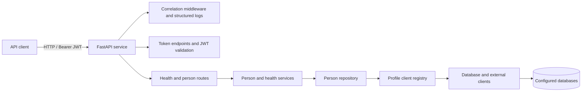
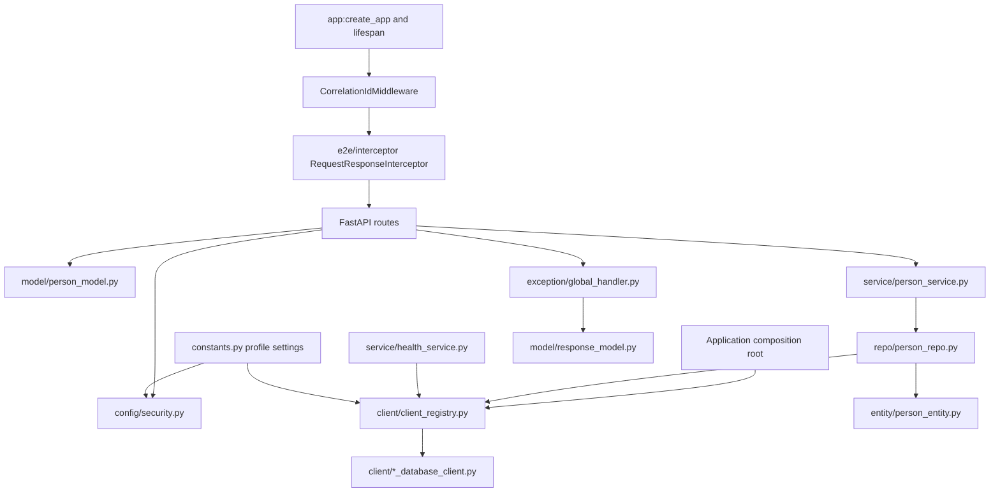
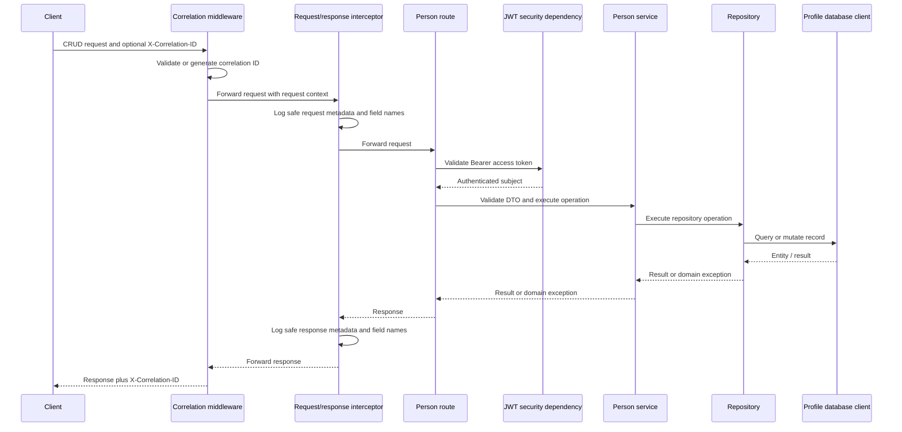

# Person Management Service

A FastAPI service following a Spring Boot–inspired layered architecture. It provides JWT-protected person CRUD, profile-based configuration, SQLite persistence, centralized error responses, and request correlation.

## Index

- [Technology stack](#technology-stack)
- [Quick start](#quick-start)
- [Configuration](#configuration)
- [Authentication](#authentication)
- [Detailed security implementation guide](docs/security-authentication.md)
- [API reference](#api-reference)
- [Architecture diagrams](#architecture-diagrams)
- [Error and logging standards](#error-and-logging-standards)
- [Docker](#docker)
- [Troubleshooting](#troubleshooting)
- [Project layout](#project-layout)

## Technology stack

| Area | Technology |
| --- | --- |
| HTTP API and OpenAPI | FastAPI, Uvicorn |
| Data validation | Pydantic v2 |
| Persistence and ORM | SQLAlchemy 2, profile-configured database clients (SQLite currently implemented) |
| Authentication | JWT access and refresh tokens (PyJWT) |
| Configuration | Profile-prefixed environment variables and python-dotenv |
| Runtime packaging | Docker and Docker Compose |

## Quick start

Python 3.12+ is recommended.

```powershell
python -m venv .venv
.\.venv\Scripts\Activate.ps1
pip install -r requirements.txt
uvicorn app:app --reload --no-access-log
```

The development profile uses an in-memory SQLite database and seeds `Ada Lovelace` once at startup. API docs are served at [Swagger UI](http://localhost:8000/swagger) and [ReDoc](http://localhost:8000/redoc) while the service is running; the OpenAPI JSON is at `/openapi.json`. The interactive architecture page is served at [http://localhost:8000/architecture](http://localhost:8000/architecture).

## Configuration

`SPRING_PROFILES_ACTIVE` selects `DEV`, `UAT`, or `PROD`, matching Spring Boot's active-profile convention. Each profile declares a comma-separated `*_DATABASE_CLIENTS` list; each name has its own `*_<NAME>_DATABASE_URL`, and `*_PRIMARY_DATABASE_CLIENT` selects the database used by person CRUD. For example, `DEV_DATABASE_CLIENTS=primary,reporting` enables two named clients; both are initialized and checked by `/health`, while `DEV_PRIMARY_DATABASE_CLIENT=primary` selects the CRUD store. Copy `.env.example` to `.env` if needed; local `.env` files are excluded from Git.

Each profile also defines the JWT signing secret and algorithm, access/refresh token lifetimes, and the single configured API username/password. `*_SEED_DATA` toggles the sample person seed; only DEV enables it by default. Seeding is idempotent and does not overwrite existing records. SQLite is the currently implemented database adapter. Other backends require their registered client adapter and SQLAlchemy driver before they can be configured; unknown backends fail clearly during client setup.

The local `.env` contains development-only placeholder credentials. Change them before exposing the service. Production startup rejects the sample secret, JWT secrets shorter than 32 characters, and passwords shorter than 12 characters or using the sample value. Supply production secrets through a secret manager in deployed environments.

## Authentication

Obtain access and refresh tokens with the configured profile credentials. In Swagger, expand **POST `/api/v1/auth/token`**, enter the active profile's `username` and `password` in the described form fields, then select **Execute**. Alternatively, use the **Authorize** button and enter the same credentials in its OAuth2 password-flow dialog. The username and password are `*_AUTH_USERNAME` and `*_AUTH_PASSWORD` in `.env` for the active `SPRING_PROFILES_ACTIVE` profile (for example, `DEV_AUTH_USERNAME` and `DEV_AUTH_PASSWORD` when the profile is `DEV`). This service does not use OAuth2 `client_id` or `client_secret`; leave both fields blank. Do not use the JWT signing secret as the password.

For a step-by-step explanation of JWTs, token issuance and validation, refresh, route protection, configuration, and security limitations, see the [detailed security implementation guide](docs/security-authentication.md).

```powershell
curl.exe -X POST http://localhost:8000/api/v1/auth/token `
  -H "Content-Type: application/x-www-form-urlencoded" `
  -d "username=admin&password=change-me"
```

Swagger's **Authorize** button applies the access token to protected endpoints. If using a manual request, send it in `Authorization: Bearer <access_token>`. Refresh by posting `{"refresh_token":"..."}` to `/api/v1/auth/refresh`. The service validates token signature, expiry, subject, and token type. Health, OpenAPI/Swagger, ReDoc, and token refresh routes are public; person CRUD requires a valid access token.

This is a starter single-user authentication flow, not a user-management or identity-provider implementation. Use a dedicated identity provider and managed secrets for production.

## API reference

| Method | Path | Auth | Purpose |
| --- | --- | --- | --- |
| GET | `/health` | Public | Readiness of the API's configured clients |
| POST | `/api/v1/auth/token` | Public | Issue access and refresh tokens |
| POST | `/api/v1/auth/refresh` | Public | Exchange a valid refresh token |
| GET | `/api/v1/people?offset=0&limit=50` | Bearer | List people |
| POST | `/api/v1/people` | Bearer | Create a person |
| GET | `/api/v1/people/{person_id}` | Bearer | Retrieve a person |
| PUT | `/api/v1/people/{person_id}` | Bearer | Replace a person's fields |
| DELETE | `/api/v1/people/{person_id}` | Bearer | Delete a person |

Example create/update body:

```json
{
  "first_name": "Grace",
  "last_name": "Hopper",
  "email": "grace@example.com",
  "phone": null
}
```

`GET /health` is a readiness check: it probes every registered client and reports each result. It returns HTTP 200 when all enabled clients are `UP`, or HTTP 503 when one or more clients are unavailable. The active profile and sanitized client statuses are included in the response.

Names are required and limited to 100 characters, email must be valid and unique, and phone is optional. List pagination accepts `offset >= 0` and `1 <= limit <= 100`. Duplicate email returns 409; a missing person returns 404.

Swagger field descriptions explain each query, path, form, and JSON body field. For `GET /api/v1/people`, `offset` is the number of records to skip and `limit` is the maximum number to return. Person IDs must be positive integers. Create requires `first_name`, `last_name`, and `email`; `phone` is optional. `PUT` updates only supplied fields and leaves omitted fields unchanged. Send `"phone": null` to clear a phone number; `first_name`, `last_name`, and `email` cannot be null. Expand an operation's **Responses** section to see success and common error status codes.

Request and response DTOs are centralized in `e2e/model/`. Their OpenAPI schemas include representative examples for token credentials and responses, refresh requests, person payloads, paginated results, health status, and standardized errors.

## Architecture diagrams

### High-level design (HLD)

Open the [interactive architecture page](http://localhost:8000/architecture) while the service is running, or serve the project root with `python -m http.server 8080` and open `http://localhost:8080/docs/architecture.html`. The interactive page lets you switch between HLD, LLD, and sequence views, select nodes, zoom, and pan; it loads Mermaid.js from a CDN.



### Low-level design (LLD)



### Request sequence



These Mermaid source diagrams render in Mermaid-compatible Markdown viewers. Use the interactive architecture page to explore the service diagrams, or the [Mermaid Live Editor](https://mermaid.live/) to edit and export diagram source.

## Error and logging standards

All API errors use a common JSON response with `timestamp`, `status`, `code`, `message`, `path`, and `correlationId`; validation errors also include safe field-level error details. Unexpected and database exceptions are logged server-side and return generic messages without stack traces or database details.

Application and server logs use structured JSON with `timestamp`, `level`, `logger`, `message`, and `correlationId` fields. The centralized `e2e/interceptor/RequestResponseInterceptor` logs every HTTP request and response, including method, route, query parameter names, allow-listed headers, content type, body size, payload field names, response status, and duration. It never logs query values, request/response body values, authorization headers, cookies, credentials, or tokens; payload field inspection is capped at 64 KiB. Layer-level auth decisions, service operations, repository queries/commits, and database session/seed lifecycle events remain separately traceable.

Requests accept a valid `X-Correlation-ID` value or generate one, propagate it through request context and every in-request log, and return it in the response header—including centralized error responses. Invalid or oversized incoming IDs are replaced with a generated UUID. Non-request process logs use the `system` correlation ID.

## Docker

```powershell
docker compose up --build
```

The service listens on port 8000. Compose configures the selected profile's file-backed SQLite database in the persistent `person-data` volume. Review the selected `SPRING_PROFILES_ACTIVE` value and replace development credentials before deployment. Uvicorn access logs are disabled so that access records without request context do not undermine request correlation; application request/error logs remain enabled.

## Troubleshooting

| Symptom | Resolution |
| --- | --- |
| Startup reports missing profile variables | Check that `.env` exists, `SPRING_PROFILES_ACTIVE` is `DEV`, `UAT`, or `PROD`, and the selected profile's variables are present. |
| Production refuses to start | Configure a unique JWT secret of at least 32 characters and a non-placeholder authentication password. |
| CRUD returns 401 | Request a token from `/api/v1/auth/token` using the active profile credentials and send it as a Bearer access token. |
| Duplicate email returns 409 | Email addresses are unique; use a different email or update the existing person. |
| Database appears empty after restart | DEV defaults to in-memory SQLite. Use a file-backed database URL or Docker Compose volume for persistence. |
| Swagger UI is unavailable | Start the service and open `http://localhost:8000/swagger`; docs are served by the running app. |

## Project layout

```text
app.py                     FastAPI factory and lifecycle
constants.py               Profile configuration loader
e2e/
  config/                 Security and startup-seeding setup
  client/                 Named external clients and client registry
  entity/                 SQLAlchemy entities
  model/                  Pydantic request/response DTOs
  repo/                   Data access; owns DB sessions and persistence
  service/                Business logic
  route/                  Authentication, health, and person routes
  exception/              Custom errors and centralized handlers
  logging/                Correlation middleware and structured logging
  interceptor/            Centralized HTTP request/response logging
  common/                 Shared non-model API utilities
```
