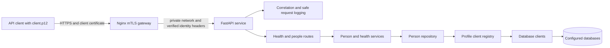
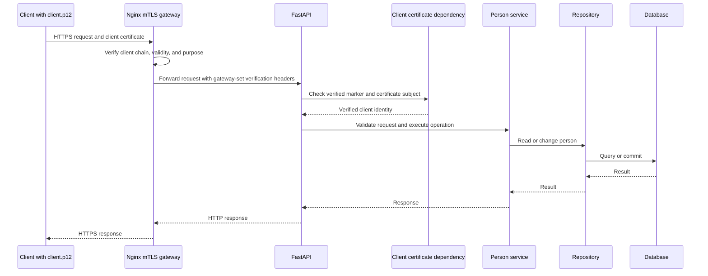

# Person Management Service

A FastAPI service following a Spring Boot-inspired layered architecture. It
provides person CRUD, profile-based configuration, SQLite persistence,
centralized error responses, request correlation, and client-certificate
authentication at an Nginx mutual-TLS (mTLS) gateway.

## Security and local quick start

The people API uses mTLS; JWT and bearer-token authentication have been removed.
The API container is not published to the host. Requests must enter through
the gateway, which requires a client certificate and forwards accepted
requests to FastAPI over a private Docker network.

Follow the [step-by-step mTLS guide](docs/client-certificate-mtls.md) to create
disposable local certificates. Then, from the repository root:

```powershell
Copy-Item .env.example .env
docker compose up --build
```

Create `certs\ca.crt`, `certs\server.crt`, `certs\server.key`, and
`certs\client.p12` by following the guide before starting Compose. The gateway
listens on `https://localhost:8443`; use the client P12 to access the API:

```powershell
curl.exe --cacert certs\ca.crt --cert-type P12 `
  --cert "certs\client.p12:<your-demo-password>" `
  https://localhost:8443/api/v1/people
```

The demo certificates are local learning material only. For organizational
use, use the approved CA, manage certificate distribution and revocation, and
restrict backend network access to the trusted gateway. See the
[API authentication notes](docs/security-authentication.md) for the security
boundary and the [mTLS guide](docs/client-certificate-mtls.md) for full steps.

## Technology stack

| Area | Technology |
| --- | --- |
| HTTP API and OpenAPI | FastAPI, Uvicorn |
| Data validation | Pydantic v2 |
| Persistence and ORM | SQLAlchemy 2, profile-configured database clients (SQLite currently implemented) |
| API authentication | Mutual TLS at the Nginx gateway |
| Configuration | Profile-prefixed environment variables and python-dotenv |
| Runtime packaging | Docker, Docker Compose, and Nginx |

## Configuration

`SPRING_PROFILES_ACTIVE` selects `DEV`, `UAT`, or `PROD`, matching Spring
Boot's active-profile convention. Each profile declares a comma-separated
`*_DATABASE_CLIENTS` list; each name has its own
`*_<NAME>_DATABASE_URL`, and `*_PRIMARY_DATABASE_CLIENT` selects the database
used by person CRUD. For example, `DEV_DATABASE_CLIENTS=primary,reporting`
enables two named clients, and `DEV_PRIMARY_DATABASE_CLIENT=primary` selects
the CRUD store. Copy `.env.example` to `.env`; local `.env` files are excluded
from Git.

`*_SEED_DATA` toggles the sample Ada Lovelace person; only DEV enables it by
default. Seeding is idempotent and does not overwrite existing records. SQLite
is the currently implemented database adapter. Other backends require their
registered client adapter and SQLAlchemy driver before they can be configured;
unknown backends fail during client setup.

## API reference

| Method | Path | Authentication | Purpose |
| --- | --- | --- | --- |
| GET | `/health` | mTLS gateway | Readiness of the API's configured clients |
| GET | `/api/v1/people?offset=0&limit=50` | Client certificate | List people |
| POST | `/api/v1/people` | Client certificate | Create a person |
| GET | `/api/v1/people/{person_id}` | Client certificate | Retrieve a person |
| PUT | `/api/v1/people/{person_id}` | Client certificate | Update a person's fields |
| DELETE | `/api/v1/people/{person_id}` | Client certificate | Delete a person |
| GET | `/swagger` | mTLS gateway | Interactive API documentation |
| GET | `/redoc` | mTLS gateway | ReDoc API documentation |

Example create/update body:

```json
{
  "first_name": "Grace",
  "last_name": "Hopper",
  "email": "grace@example.com",
  "phone": null
}
```

Names are required and limited to 100 characters, email must be valid and
unique, and phone is optional. List pagination accepts `offset >= 0` and
`1 <= limit <= 100`. Duplicate email returns 409; a missing person returns
404. PUT updates only supplied fields; send `"phone": null` to clear the phone.

`GET /health` is a readiness check: it probes every registered database client
and reports each result. It returns HTTP 200 when all enabled clients are `UP`,
or HTTP 503 when a client is unavailable. It is still behind mTLS in the
Compose deployment.

Request and response DTOs are centralized in `e2e/model/`. Swagger shows
descriptions and examples for query, path, and JSON body fields. Use the
certificate-authenticated gateway to open the documentation.

## Architecture

### High-level design



### Request sequence



The interactive HLD/LLD/sequence diagram page is available at
`https://localhost:8443/architecture` through the mTLS gateway; alternatively
serve the project root with `python -m http.server 8080` to view its static
HTML without calling the API. The interactive page loads Mermaid.js from a
CDN.

## Logging and errors

All API errors use a common JSON response with `timestamp`, `status`, `code`,
`message`, `path`, and `correlationId`; validation errors also include safe
field-level details. Unexpected and database exceptions are logged server-side
and return generic messages.

Application logs use structured JSON with timestamp, level, logger, message,
and correlation ID. The request/response interceptor records safe metadata
such as route, method, payload field names, response status, and duration; it
does not record request/response values or credentials. A valid incoming
`X-Correlation-ID` is propagated or a new UUID is generated.

## Docker deployment

```powershell
Copy-Item .env.example .env
docker compose up --build
```

Generate the demo TLS files first as described in the [mTLS guide](docs/client-certificate-mtls.md).
Compose publishes only the Nginx gateway on port 8443. It does not publish the
FastAPI service port. Compose uses a persistent `person-data` volume for its
file-backed SQLite database. For production, mount managed certificate
material securely and use the organization's gateway/certificate policy
instead of the local demo CA.

## Troubleshooting

| Symptom | Resolution |
| --- | --- |
| `openssl` is not recognized | Install OpenSSL and ensure it is available in PowerShell's `PATH`. |
| Compose reports missing TLS files | Generate `ca.crt`, `server.crt`, and `server.key` under `certs\` using the mTLS guide. |
| TLS handshake fails | Ensure the gateway is running and the client certificate is valid, trusted, and has the correct P12 password. |
| People API returns 401 | Use the gateway with a valid client certificate; do not call the unpublished FastAPI port directly. |
| Duplicate email returns 409 | Email addresses are unique; use a different email or update the existing record. |
| Database appears empty after restart | DEV defaults to in-memory SQLite when run directly; Compose uses its persistent database volume. |
| Swagger UI is unavailable | Open `https://localhost:8443/swagger` with the client certificate available to your browser. |

## Project layout

```text
app.py                     FastAPI factory and lifecycle
constants.py               Profile configuration loader
nginx/default.conf         HTTPS mTLS gateway and identity forwarding
e2e/
  config/                  Gateway identity check and startup seeding
  client/                  Named database clients and client registry
  entity/                  SQLAlchemy entities
  model/                   Pydantic request/response DTOs
  repo/                    Data access and persistence
  service/                 Business logic
  route/                   Health and people routes
  exception/               Custom errors and centralized handlers
  logging/                 Correlation middleware and structured logging
  interceptor/             Centralized HTTP request/response logging
```
