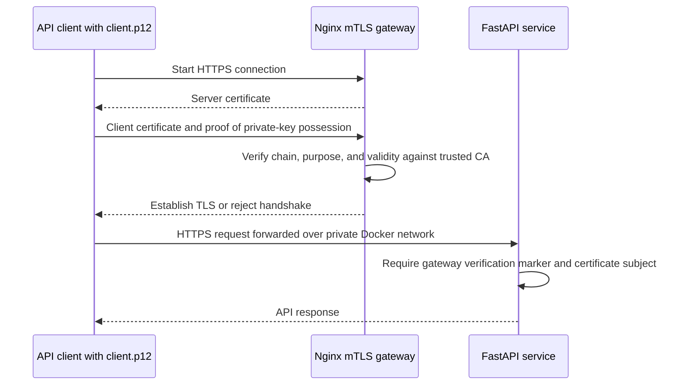

# Protecting this API with a client certificate (mTLS)

This step-by-step guide explains mutual TLS (mTLS), creates disposable
certificates for local learning, starts this API behind its Nginx mTLS gateway,
and calls protected endpoints using a client `.p12` file. This application no
longer uses JWT or bearer tokens.

> **Demo only:** The local CA, certificates, and password you create here are
> not trusted by your organization or the public internet. Never use these
> files in production.

## 1. Understand what happens

HTTPS uses TLS to encrypt traffic and let the client verify the server. With
mTLS, the server also asks the client to prove its identity using a certificate.
A `.p12` file (PKCS#12/PFX) is a password-protected package containing the
client's certificate and private key. The private key stays on the client; it
is not sent to the API. Instead, the TLS handshake proves the client possesses
that key.



| File or item | Who keeps/uses it? | Purpose |
| --- | --- | --- |
| `client.p12` | API client | Client certificate and private key for the TLS handshake. This is the client credential to provision for Chrome or a P12-capable client. |
| `client.crt` / `client.key` | API client, if needed | PEM form of the same client identity for clients that cannot use P12. Keep `client.key` secret; do not distribute it separately when using `client.p12`. |
| `ca.crt` | Gateway; client trusts it for this demo | Public CA certificate. The gateway uses it to verify client certificates; the browser/OS may need it to trust the demo server certificate. It is not a client credential. |
| `server.crt` / `server.key` | Gateway | Server identity and private key for HTTPS; keep the key secret. |
| `ca.key` | Issuance only | Signs certificates; do not copy it to the gateway or client. Remove it after creating this disposable demo set. |

The gateway validates the certificate. It then overwrites two HTTP headers with
the verified handshake result and subject. FastAPI checks these headers on
people routes. This is safe only because the API port is not published and the
gateway is the only service on the private Compose network. The application
does not receive or inspect the client's private key.

For this setup, provision `client.p12` to the API client through an approved
secure channel and provide its password separately. Do not commit or email the
file, and do not share `ca.key`, `server.key`, or `client.key`. Because this
demo uses a locally generated CA, a browser may also need `ca.crt` installed
as a trusted CA to validate the HTTPS server. `ca.crt` is public and is
separate from the client credential.

## 2. Create demo certificates on Windows

Install a current OpenSSL release (1.1.1 or newer) if needed. From the
repository root, create a local directory for the certificate files and switch
into it:

```powershell
New-Item -ItemType Directory -Force certs | Out-Null
Set-Location certs
openssl version
```

The repository ignores the contents of `certs` so private keys and `.p12`
bundles are not accidentally checked in. Run each following command from this
directory. The issuance steps create client and server credentials. To start
the Compose services, only `ca.crt`, `server.crt`, and `server.key` are needed;
`client.p12` is not mounted into or required by the service. Keep it for the
client that will call the API. The optional `client.crt` and `client.key` are
for clients that need PEM credentials. The cleanup step removes the CA private
key and temporary issuance files but leaves the six runtime/client files.
This is a disposable local CA; if you need to renew this demo set after
deleting its CA key, generate a fresh set.

### 2.1 Create a demo certificate authority (CA)

The CA signs both server and client certificates. Protect `ca.key`; the
gateway uses only the public `ca.crt` to verify client certificates.

```powershell
openssl genpkey -algorithm RSA -pkeyopt rsa_keygen_bits:3072 -out ca.key
openssl req -x509 -new -sha256 -days 30 -key ca.key `
  -out ca.crt -subj "/CN=Local Demo CA" `
  -addext "basicConstraints=critical,CA:TRUE" `
  -addext "keyUsage=critical,keyCertSign,cRLSign"
```

### 2.2 Create the HTTPS server certificate

The subject alternative name (SAN) must match the host used by the client;
this example covers `localhost` and `127.0.0.1`.

```powershell
openssl genpkey -algorithm RSA -pkeyopt rsa_keygen_bits:2048 -out server.key
openssl req -new -key server.key -out server.csr -subj "/CN=localhost"
@'
[server_ext]
basicConstraints = critical,CA:FALSE
keyUsage = critical,digitalSignature,keyEncipherment
extendedKeyUsage = serverAuth
subjectAltName = DNS:localhost,IP:127.0.0.1
'@ | Set-Content -Encoding ascii server-ext.cnf
openssl x509 -req -sha256 -days 30 -in server.csr `
  -CA ca.crt -CAkey ca.key -CAcreateserial `
  -out server.crt -extfile server-ext.cnf -extensions server_ext
```

### 2.3 Create a client certificate and `.p12`

The `clientAuth` purpose marks this as a client certificate.

```powershell
openssl genpkey -algorithm RSA -pkeyopt rsa_keygen_bits:2048 -out client.key
openssl req -new -key client.key -out client.csr -subj "/CN=demo-api-client"
@'
[client_ext]
basicConstraints = critical,CA:FALSE
keyUsage = critical,digitalSignature
extendedKeyUsage = clientAuth
'@ | Set-Content -Encoding ascii client-ext.cnf
openssl x509 -req -sha256 -days 30 -in client.csr `
  -CA ca.crt -CAkey ca.key -CAcreateserial `
  -out client.crt -extfile client-ext.cnf -extensions client_ext
openssl pkcs12 -export -out client.p12 -inkey client.key `
  -in client.crt -certfile ca.crt -name "demo-api-client" `
  -passout pass:LocalDemoOnly2026
```

The P12 password for this local demo is **`LocalDemoOnly2026`**. It is
intentionally written here for convenience; anyone who can read this guide
can see it. Do not reuse it or these demo credentials outside this local
setup.

Verify both certificates chain to the demo CA and that the P12 opens with the
documented password:

```powershell
openssl verify -CAfile ca.crt server.crt
openssl verify -CAfile ca.crt client.crt
openssl pkcs12 -info -in client.p12 -noout -passin pass:LocalDemoOnly2026
Remove-Item ca.key, ca.srl, server.csr, server-ext.cnf, client.csr, client-ext.cnf
```

Both `verify` commands should report `OK`. The P12 check displays bundle
metadata; do not use commands that print private key contents. The final
command removes the CA signing key and temporary issuance files, leaving only
`ca.crt`, `server.crt`, `server.key`, `client.crt`, `client.key`, and
`client.p12` in `certs`.

For service startup, `ca.crt`, `server.crt`, and `server.key` must be present
under `certs`. Retain `client.p12` for the API client; it is not needed by
Docker Compose. The remaining client PEM files are only needed if a client
uses PEM instead of the P12 bundle.

## 3. Start this project with mTLS enabled

The Compose setup uses these files from the repository's `certs` directory:

- `server.crt` and `server.key` for the HTTPS gateway.
- `ca.crt` for the gateway to trust client certificates.

It does not mount or need `client.p12`, `client.crt`, or `client.key`; those
are client-side credentials. Confirm the three gateway files exist before
starting Compose.

Return to the repository root, create the local environment file, and start
the service:

```powershell
Set-Location ..
Copy-Item .env.example .env
docker compose up --build
```

The `mtls-gateway` service exposes HTTPS on port `8443`. The FastAPI service
listens on port `8000` inside Compose but has **no host-published port**. The
gateway requires a client certificate for all routes, including health and API
documentation, and proxies accepted requests to FastAPI over a private Docker
network.

```text
client.p12 -- HTTPS/mTLS --> Nginx gateway -- private network --> FastAPI
                                 | checks CA                    | checks
                                 | expiry and purpose            | gateway headers
```

The Nginx configuration sets `X-Client-Verify` to the TLS result and
`X-Client-Subject` to the verified certificate subject. Because Nginx
overwrites these headers, a client cannot supply its own values through the
gateway. FastAPI rejects people API requests without the success marker and
subject. Do not publish port `8000` or otherwise allow untrusted clients to
reach FastAPI directly: a direct caller could forge ordinary HTTP headers.

### Call the API using the `.p12`

In a second PowerShell window, from the repository root:

```powershell
curl.exe --cacert certs\ca.crt --cert-type P12 `
  --cert "certs\client.p12:LocalDemoOnly2026" `
  https://localhost:8443/api/v1/people
```

Successful requests return a people page; no token endpoint, username/password,
or authorization header is needed. Other people endpoints use the same curl
certificate options. Health and Swagger are also protected:

```text
https://localhost:8443/health
https://localhost:8443/swagger
```

If the Windows `curl.exe` build uses Schannel and cannot import PEM certificate
files, Docker can run an OpenSSL-based curl client using the PEM pair instead.
From the repository root:

```powershell
$gateway = docker compose ps -q mtls-gateway
docker run --rm --user 0:0 --network "container:$gateway" `
  -v "${PWD}\certs:/certs:ro" curlimages/curl:8.12.1 `
  --cacert /certs/ca.crt --cert /certs/client.crt --key /certs/client.key `
  https://localhost:8443/api/v1/people
```

This uses the gateway container's network namespace so the server certificate
is still checked against `localhost`. `--user 0:0` allows the temporary
container to read certificate files from the Windows bind mount. It requires
Docker to be running and may download the curl image the first time.

For Chrome, install `client.p12` into the user's personal certificate store
and provide its password when prompted; Chrome can then present it when the
gateway requests a client certificate. The browser/OS may also need `ca.crt`
installed as a trusted CA so it accepts the demo HTTPS server certificate.
These are separate purposes: `client.p12` authenticates the caller, while
`ca.crt` lets the client verify the server. Share the P12 through an approved
secure channel and its password separately. Some Windows `curl.exe` builds
do not support PKCS#12: check
`curl.exe -V` for its TLS backend and use a client that supports P12 if needed.
Avoid putting real certificate passwords in shared terminals because command
history and process listings may expose command-line arguments.

### Confirm the gateway rejects a client without a certificate

From the repository root, try a request without the client certificate:

```powershell
$gateway = docker compose ps -q mtls-gateway
docker run --rm --user 0:0 --network "container:$gateway" `
  -v "${PWD}\certs:/certs:ro" curlimages/curl:8.12.1 `
  --cacert /certs/ca.crt https://localhost:8443/api/v1/people
```

Nginx should reject the request with `400 No required SSL certificate was
sent`. With a certificate, an API `401` usually means the request did not
reach FastAPI through the configured gateway or the gateway identity headers
were not passed as configured.

## 4. How to use this in an organization

The demo CA is not a substitute for organizational PKI. For a real deployment:

1. Request a client certificate from the organization's approved CA for each
   calling application/environment. Export or provision it as `.p12` according
   to company policy.
2. Keep the client `.p12` and its password in an approved secret store or
   managed keystore. Do not email it, commit it, or share one certificate among
   unrelated clients.
3. Install the organization's trusted client CA certificate at the gateway.
   Configure the gateway's server certificate separately, and require client
   certificate verification.
4. Ensure the backend is reachable only from the trusted gateway. The
   gateway must overwrite client-certificate identity headers; never trust
   caller-supplied identity headers.
5. Define how certificate subjects map to API permissions. This starter
   currently gives every certificate issued by the configured CA the same
   people API access; a certificate identity alone is not a role/permission
   system.
6. Plan issuance, expiry monitoring, renewal, revocation, and incident
   response with the certificate/security owners.

The gateway performs certificate chain and TLS client-purpose checks. This
application only receives the gateway's verification result and subject over
the private network; it does not perform certificate revocation checks itself.
Set up revocation handling at the gateway according to your organization's CA
and infrastructure.

## 5. Troubleshooting and safety

| Symptom | What to check |
| --- | --- |
| `openssl` is not recognized | Install OpenSSL and ensure it is available in PowerShell's `PATH`. |
| Certificate verification is not `OK` | Confirm the client/server certificates were signed by the same `ca.crt` and rerun the commands from `certs`. |
| TLS handshake fails | Check that the gateway is running, the `.p12` password is correct, and the client certificate is trusted and valid for client authentication. |
| Hostname verification fails | Use `https://localhost:8443` with the demo server certificate, or create a server certificate whose SAN matches the hostname. |
| API returns `401` after TLS succeeds | Confirm the request used the Compose gateway and that the gateway forwarded the verification marker and certificate subject. |
| Compose reports missing certificate files | Generate `ca.crt`, `server.crt`, and `server.key` under the repository's `certs` directory. |

Treat `ca.key`, `server.key`, `client.key`, and `client.p12` as secrets.
Restrict access, do not log or upload them, and remove demo files securely when
they are no longer needed. Never use these demo certificates or passwords in
production.
