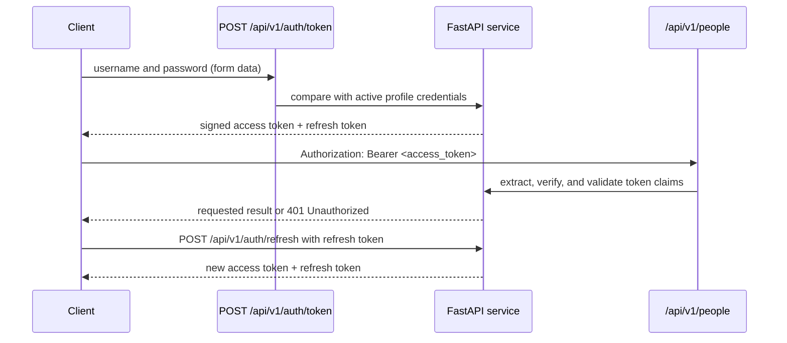

# Security and Token Authentication: Step-by-Step Guide

This guide explains how authentication and bearer-token protection work in the
Person Management Service, how to use the flow, and how to apply the same
building blocks when adding token authentication to another FastAPI service.
It assumes no prior knowledge of OAuth 2.0 or JSON Web Tokens (JWTs).

> **Important scope note:** this project implements a simple, single-account
> example for learning and local development. It is not a full identity system:
> there are no user accounts, password-reset flows, roles, permissions, token
> revocation, or refresh-token rotation. For a production system with real
> users, prefer a trusted identity provider and OpenID Connect rather than
> building an identity platform from scratch.

## 1. The basic concepts

### Authentication and authorization

- **Authentication** answers: "Who are you?" Here, the client submits a
  configured username and password to obtain tokens.
- **Authorization** answers: "May you perform this action?" In this service,
  every request with a valid access token for the configured account can use
  the protected people endpoints. There are no per-user roles or permissions.

Passing authentication does not automatically imply that an application has
fine-grained authorization rules. Add and enforce permissions separately if
different users should have different access.

### Access token

An access token is a short-lived credential sent with protected API requests.
This service uses a JWT (JSON Web Token), signed by the service. A JWT contains
three base64url-encoded parts: a header, a payload, and a signature. The payload
is **not encrypted**; anyone holding the token can read its claims. The
signature lets the service detect changes, but does not hide the contents.

This project's access token contains:

| Claim | Meaning |
| --- | --- |
| `sub` | The configured account name (the token subject) |
| `type` | `access`, so it can be distinguished from a refresh token |
| `iat` | Issued-at time |
| `exp` | Expiration time |

Do not put passwords, signing secrets, or other confidential data in a JWT
payload. A signed JWT is tamper-evident, not secret.

### Refresh token

A refresh token is a longer-lived credential exchanged for a new access and
refresh token pair. It is not accepted for people API calls. Keeping access
tokens short-lived limits how long a stolen access token can be used; the
refresh token lets a client obtain a new pair without asking for the password
again.

In this starter implementation, refresh tokens are also signed JWTs. An old
refresh token remains usable until it expires: the service does not store token
state, rotate/revoke refresh tokens, or provide logout-based invalidation.
Treat refresh tokens as highly sensitive credentials.

### OAuth 2.0 and bearer authentication

OAuth 2.0 is a framework for issuing and using access tokens. A **bearer**
token means that the caller possessing the token can use it; the server does
not require a separate proof of possession. Anyone who steals a bearer token
can use it until it expires or is otherwise rejected.

The service follows the OAuth2 password-flow shape for the Swagger UI and
development example. The OAuth2 `client_id` and `client_secret` fields are not
used by this implementation. The username and password are the application's
configured account credentials, not OAuth client credentials and not the JWT
signing secret.

## 2. The request flow at a glance



The application wiring is in [`app.py`](../app.py): it adds the authentication
and people routers under `/api/v1`. Token operations are in
[`e2e/route/auth_route.py`](../e2e/route/auth_route.py). JWT creation,
verification, and the protected-route dependency are in
[`e2e/config/security.py`](../e2e/config/security.py).

## 3. Configure credentials and token settings

The settings loader in [`constants.py`](../constants.py) reads the selected
profile from `SPRING_PROFILES_ACTIVE` (`DEV`, `UAT`, or `PROD`). It loads only
that profile's variables. For example, with `SPRING_PROFILES_ACTIVE=DEV`, the
authentication settings are:

| Setting | Purpose |
| --- | --- |
| `DEV_AUTH_USERNAME` | Username accepted by the token endpoint |
| `DEV_AUTH_PASSWORD` | Password accepted by the token endpoint |
| `DEV_JWT_SECRET` | Private key used to sign and verify this profile's tokens |
| `DEV_JWT_ALGORITHM` | Allowed signing algorithm (`HS256`, `HS384`, or `HS512`) |
| `DEV_ACCESS_TOKEN_MINUTES` | Access-token lifetime; defaults to 30 minutes |
| `DEV_REFRESH_TOKEN_DAYS` | Refresh-token lifetime; defaults to 7 days |

The corresponding UAT and PROD settings use `UAT_` and `PROD_` prefixes. The
sample values in [`.env.example`](../.env.example) are for local development
only. Do not use them in a deployed environment. Local `.env` files should not
be committed to source control.

At startup, `load_settings()` rejects unknown profiles, unsupported signing
algorithms, missing required values, and non-positive token lifetimes. It also
enforces stronger minimum checks for the production signing secret and
password. Configuration checks cannot replace secure secret generation,
storage, access control, and rotation in the deployment environment.

The password in this starter service is a single configured environment value;
it is not a user account stored in a database and is not password-hashed. A
real multi-user service should use a vetted password-hashing algorithm such as
Argon2id or bcrypt, with a unique salt per password, and a managed user
identity system. Never store ordinary user passwords as plaintext.

## 4. Request a token pair

Send a form-encoded POST request to `/api/v1/auth/token`. The fields are:

- `username`: the active profile's `*_AUTH_USERNAME`.
- `password`: the active profile's `*_AUTH_PASSWORD`.

The endpoint and response schema are documented in
[`e2e/route/auth_route.py`](../e2e/route/auth_route.py) and
[`e2e/model/auth_model.py`](../e2e/model/auth_model.py). For example, from
PowerShell, replace the placeholders with values from your local `.env`:

```powershell
curl.exe -X POST http://localhost:8000/api/v1/auth/token `
  -H "Content-Type: application/x-www-form-urlencoded" `
  --data-urlencode "username=<DEV_AUTH_USERNAME>" `
  --data-urlencode "password=<DEV_AUTH_PASSWORD>"
```

Do not paste real passwords or tokens into shared terminals, tickets, chat, or
source control. Be aware that shell history and process inspection may retain
command-line values; Swagger or a secure API client can be preferable for
interactive use.

`TokenRequest` validates the submitted form fields. `credentials_match()` uses
constant-time comparison for the configured username and password. If they do
not match, the endpoint returns `401 Unauthorized`; it does not issue a token.
If they match, the route calls `_tokens()` to issue an access token and a
refresh token.

A successful response has this shape (the token strings below are illustrative
placeholders, not usable credentials):

```json
{
  "access_token": "<signed-access-token>",
  "refresh_token": "<signed-refresh-token>",
  "token_type": "bearer"
}
```

`token_type` tells clients which authorization scheme to use. The token strings
are sensitive: do not log them, place them in a URL, or commit them.

## 5. How this service creates and verifies JWTs

`create_token()` in [`e2e/config/security.py`](../e2e/config/security.py)
creates the claims and signs them using the active profile's secret and
algorithm:

1. It records the current UTC time as `iat`.
2. It calculates `exp` using the configured lifetime.
3. It sets `sub` to the configured username.
4. It sets `type` to either `access` or `refresh`.
5. PyJWT signs the claims with the configured HMAC algorithm and secret.

The same service uses `decode_token()` to verify the signature and expiration.
The algorithm is taken from validated settings rather than trusted from
untrusted request data. Do not accept arbitrary algorithms or skip signature
verification.

Because this service uses a shared HMAC secret, every service that can verify
tokens also has the ability to create them. In a larger system, consider an
identity provider or asymmetric signing (for example, a private key signs and
public keys verify) with key IDs and a safe key-rotation plan.

## 6. Call a protected endpoint

Send the access token in the HTTP `Authorization` header:

```text
Authorization: Bearer <access_token>
```

For example, a request to `GET /api/v1/people` must include that header.
`Bearer` is the authentication scheme; it is followed by a space and the
access-token value. Use HTTPS outside local development so credentials and
tokens are encrypted in transit.

In Swagger at `/swagger`, click **Authorize** and enter the configured
username and password. Leave `client_id` and `client_secret` empty. Swagger
obtains a token and attaches the access token to protected API calls. The
`OAuth2PasswordBearer` declaration in
[`e2e/config/security.py`](../e2e/config/security.py) tells FastAPI the token
URL and describes this flow in OpenAPI; it does **not** itself validate a JWT.

The actual enforcement happens in two steps:

1. `OAuth2PasswordBearer` extracts the bearer value from the authorization
   header. If the header is missing, FastAPI rejects the request as
   unauthenticated.
2. `get_current_user()` calls `decode_token()` and checks that the token has
   `type == "access"` and `sub` equal to the configured account. Invalid,
   expired, refresh-type, or wrong-subject tokens are rejected with
   `401 Unauthorized`.

The people router applies `Depends(get_current_user)` to the router, so it
protects all its endpoints consistently; see
[`e2e/route/person_route.py`](../e2e/route/person_route.py). The health and
authentication routers are not protected by that dependency in this project.
For a new protected router, use the same router-level dependency or add the
dependency to an individual endpoint. Put authorization checks close to the
server-side operation that they protect; hiding a button in a client is not
access control.

## 7. Refresh an expired or soon-to-expire access token

Send the refresh token in JSON to `POST /api/v1/auth/refresh`:

```json
{
  "refresh_token": "<signed-refresh-token>"
}
```

The route verifies the signature and expiry, then checks both the `type`
(`refresh`) and the configured `sub`. On success, it returns a new pair. A
malformed, expired, access-type, or wrong-subject token is rejected.

The refresh endpoint is public in the sense that it does not require an access
token; it still requires a valid refresh token in the request body. Do not send
the refresh token to people endpoints. In this implementation, a previously
issued refresh token is not invalidated when a new pair is issued. If an
application needs logout, immediate revocation, or replay detection, it needs
server-side token state or a provider with those capabilities.

## 8. Errors and safe observability

Common outcomes include:

| Situation | Result |
| --- | --- |
| Missing bearer header on a protected route | `401 Unauthorized` |
| Invalid, expired, or wrong-purpose access token | `401 Unauthorized` |
| Invalid username/password | `401 Unauthorized` |
| Invalid request fields | `422 Unprocessable Entity` |
| Valid token and valid request | Normal endpoint response |

The centralized handlers in
[`e2e/exception/global_handler.py`](../e2e/exception/global_handler.py)
return sanitized error bodies. Validation errors omit the submitted values,
which matters because token requests contain credentials.

The HTTP interceptor in
[`e2e/interceptor/request_response_interceptor.py`](../e2e/interceptor/request_response_interceptor.py)
logs request metadata and payload field names, not request or response values.
It also excludes the `Authorization` header from its header allowlist.
Authentication decisions are logged without recording raw token strings.
Preserve these properties when adding logging or diagnostics; never log
passwords, signing secrets, access tokens, or refresh tokens.

## 9. Reuse this pattern in another FastAPI service

Use the following implementation order as a learning checklist:

1. **Decide the identity model.** Determine whether users come from an
   identity provider, a user database, or (only for a simple example) one
   configured account. Decide how roles and permissions will be represented.
2. **Configure secrets safely.** Load a signing key and token lifetimes from
   environment-backed configuration or a secret manager. Validate the
   algorithm and settings at startup. Never hard-code production secrets.
3. **Define request and response schemas.** Validate login input and return a
   consistent token response. Do not return passwords or signing keys.
4. **Implement credential verification.** For stored passwords, use a vetted
   password hash verifier. Avoid leaking whether a username or password was
   specifically incorrect.
5. **Issue signed tokens.** Include only the minimum claims needed, especially
   subject, expiry, issued-at, and a clear token purpose. Sign only with a
   server-controlled algorithm and key.
6. **Extract credentials on protected routes.** Use a framework security
   dependency to read the bearer token from the `Authorization` header.
7. **Verify on every protected request.** Validate the signature, expiry,
   issuer and audience where applicable, token purpose, subject, and any
   required permissions. Do not trust claims until verification succeeds.
8. **Add refresh behavior deliberately.** Define refresh expiry, rotation,
   reuse detection, revocation, and logout semantics before relying on refresh
   tokens in production.
9. **Protect transport and storage.** Require HTTPS, keep tokens out of URLs
   and logs, store client tokens securely, and keep signing keys in managed
   secret storage.
10. **Test security behavior.** Cover missing, malformed, expired, wrong-key,
    wrong-purpose, and insufficient-permission tokens, as well as successful
    authentication and token refresh.

For a production browser or mobile application, consult current OAuth 2.0 and
OpenID Connect guidance and use Authorization Code with PKCE through a
reputable identity provider. The password-flow example in this service is
intended to make the mechanics easy to inspect, not to recommend collecting
user passwords in a new application.

## 10. Source-code map

| Concern | Implementation |
| --- | --- |
| Profile settings and production checks | [`constants.py`](../constants.py) |
| Example profile environment variable names | [`.env.example`](../.env.example) |
| Token request/response DTOs | [`e2e/model/auth_model.py`](../e2e/model/auth_model.py) |
| Token issuance and refresh routes | [`e2e/route/auth_route.py`](../e2e/route/auth_route.py) |
| JWT creation, decoding, and access dependency | [`e2e/config/security.py`](../e2e/config/security.py) |
| Router registration and API composition | [`app.py`](../app.py) |
| Protected people endpoints | [`e2e/route/person_route.py`](../e2e/route/person_route.py) |
| Sanitized HTTP errors | [`e2e/exception/global_handler.py`](../e2e/exception/global_handler.py) |
| Request/response metadata logging | [`e2e/interceptor/request_response_interceptor.py`](../e2e/interceptor/request_response_interceptor.py) |

